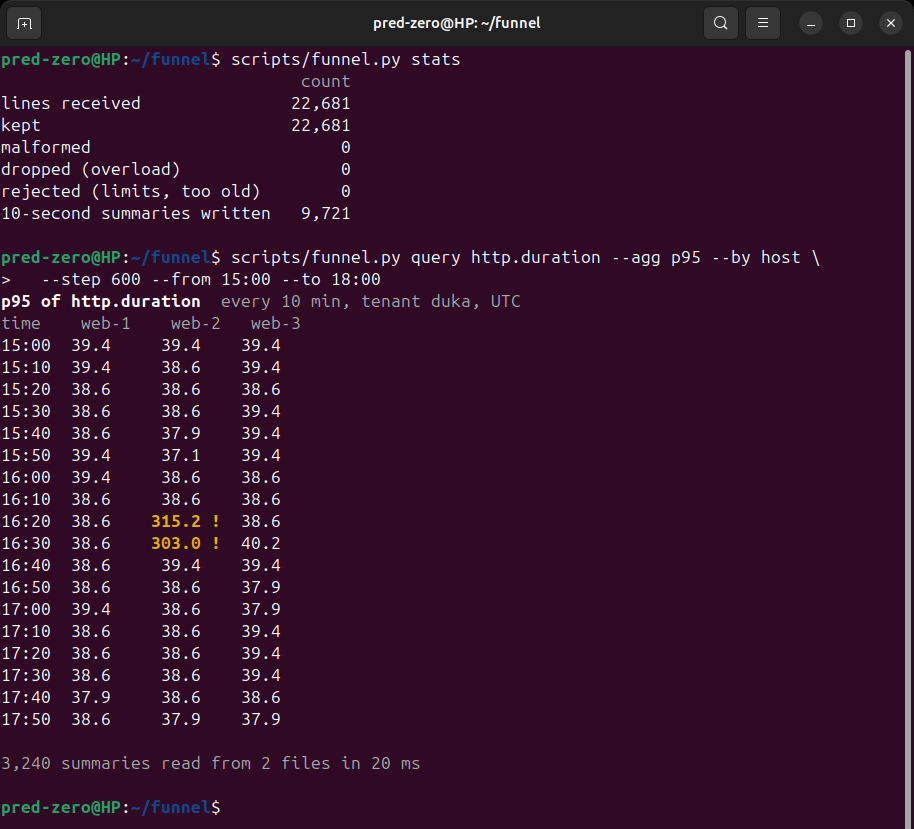
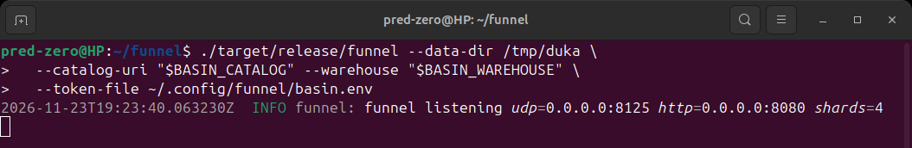
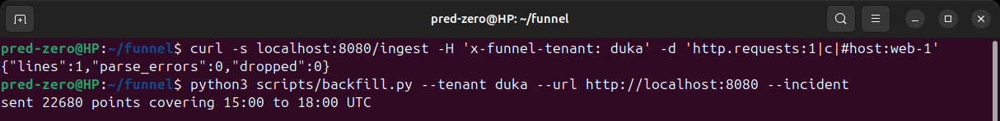
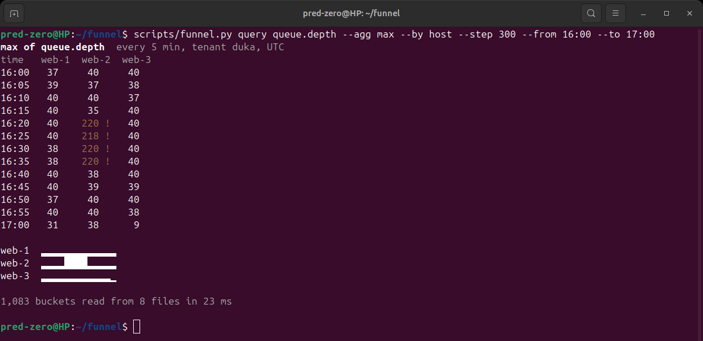
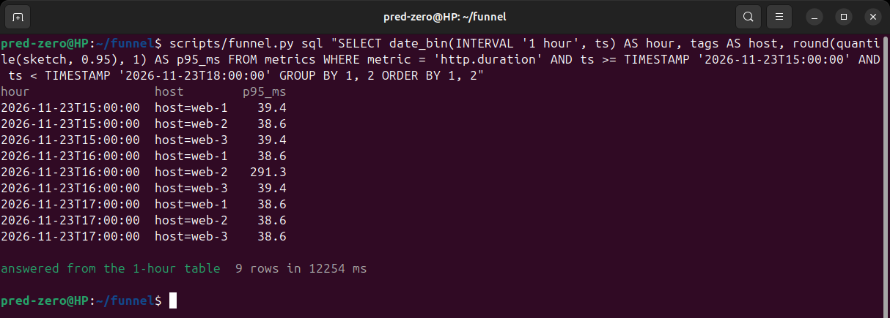
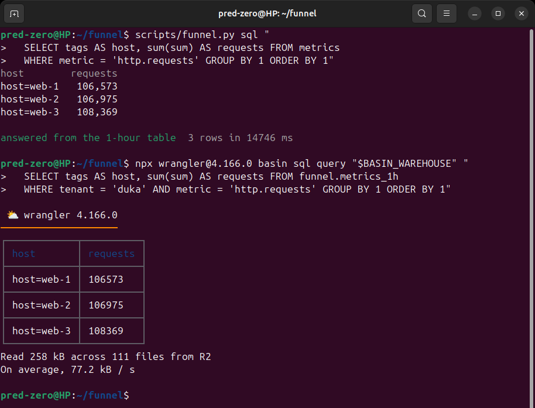

# Funnel

Funnel stores the numbers your servers report about themselves: how many requests they handled,
how long each one took, how full their queues are. It keeps a 10-second summary instead of every
number, which makes it cheap enough to run on a $6 server, and it can save the history as
[Apache Iceberg](https://iceberg.apache.org/) tables on your own disk or in a Cloudflare R2
bucket, where any SQL engine can read it.



That table is Funnel telling you one of three servers got slow for twenty minutes. The rest of
this page follows that afternoon from start to finish. Every screenshot is a real run on a laptop.

## A slow afternoon at Duka

Wanjiru runs the backend for Duka, a small online shop. Three web servers, `web-1` to `web-3`,
handle the traffic. Each one reports its request count, how long each request took, and how many
requests are waiting in its queue.

### 1. Start Funnel

Funnel is one program. Here it keeps recent data in `/tmp/duka` and publishes every finished hour
to Basin Catalog, Cloudflare's Iceberg catalog on R2. `$BASIN_CATALOG` and `$BASIN_WAREHOUSE` hold
the bucket's address, and the token file holds an R2 API token.



It listens for metrics on UDP port 8125 and HTTP port 8080. Without the catalog flags it keeps
everything on local disk.

### 2. The servers send numbers

Servers send one line per measurement in the [StatsD](https://github.com/statsd/statsd) format,
which most languages already have a client for. `http.requests:1|c|#host:web-1` means "add 1 to the
request counter of web-1". The first command below sends one line by hand. The second plays back
three hours of traffic from all three servers, including the slow patch on web-2.



Funnel received 22,681 lines and kept them as 9,721 summaries (the stats at the top of the first
screenshot), one per server per metric per 10 seconds. Each summary holds enough to answer the usual questions later: the total, the minimum and
maximum, and a small [sketch](crates/sketch) of about 1 KB that gives any percentile to within 1%.
This demo sends only a few numbers per 10 seconds. Real traffic sends far more, and on a simulated
backend of 7,000 series each summary replaced 41 raw numbers.

### 3. Which server is slow?

Customers say checkout felt slow around 4 pm. Wanjiru asks for the 95th percentile of request time
on each server, in 10-minute steps. That's the time 95% of requests finished within.

The answer is the table at the top of this page. web-1 and web-3 stay at about 39 ms all afternoon. web-2 jumps to 315 ms at 16:20 and 303 ms at
16:30, then recovers. The `!` marks values far above the rest. Funnel answered from 3,240
summaries in 20 ms.

### 4. Was web-2 backed up?

Slow requests usually mean a queue is building, so she checks the deepest queue on each server in
5-minute steps.



web-2's queue held up to 220 requests from 16:20 to 16:35, while the other two never passed 40.
So the slowdown was one server falling behind while the other two kept up.

### 5. A week later, in SQL

Every finished hour is also written to Iceberg tables, and Funnel answers SQL over them. A week
later, writing up the incident, Wanjiru wants the hourly numbers.



The query names a table called `metrics`, which holds one row per series per 10 seconds. Funnel
also keeps copies summed to 1 minute, 10 minutes and 1 hour, and its query planner moved this
query to the 1-hour table because that gives exactly the same answer from far fewer rows. On a
week of data from 200 servers, that made the same kind of query 31 times faster.

This query took about 17 seconds, nearly all of it spent talking to Cloudflare's catalog and
storage from the laptop. With the tables on local disk, a 7-day query takes under half a second.

### 6. The same data, read by Cloudflare

The tables are plain Iceberg, so other engines can read them without any export. Here Funnel and
Cloudflare's own engine, [Basin SQL](https://developers.cloudflare.com/basin-sql/), count requests
per server.



Both return 106,573, 106,975 and 108,369. Basin SQL read 258 kB from R2 to answer. Basin SQL can't read the latency sketches, which are Funnel's own
binary format, so percentiles still come from Funnel. Counts, sums, minimums and maximums work in
both.

## Why it exists

Hosted metrics get expensive in two ways. One is volume: a service handling 5,000 requests a
second produces 432 million latency numbers a day, and dashboards only ever read them as
summaries. The other is labels: every new combination of tags is billed as its own series, and a
tag like a user ID can create millions overnight.

Sentry's ingestion service, Relay, already summarizes metrics into 10-second buckets before storing
them, and until April 2026 it also capped how many series each organization could create. Funnel
puts both ideas in one small program and measures what they save.

## What it saves

One cloud vCPU takes 1.5 to 2 million lines a second without dropping any. The stored data needs
5.6 times less disk than the same raw points in ClickHouse with its best codecs, and percentiles
stay within 1% of the exact answer. A workload of 7,000 series that would cost about $1,925 a month
on Datadog, or $295 to $360 on Grafana Cloud at list prices, fits on a $6 to $12 server.
[WRITEUP.md](WRITEUP.md) has the measurements.

Picking the smallest table that gives the same answer matters most for long ranges. On a laptop
with 7 days of data from 200 servers (36.3 million rows):

| Dashboard | Table used | Without | With | Faster by |
|---|---|---|---|---|
| p99 latency, 7 days, per hour | 1 hour | 13,524 ms | 428 ms | 31.6x |
| peak queue per server, 7 days | 1 hour | 1,381 ms | 290 ms | 4.8x |
| request total, 1 day, per 10 minutes | 10 minutes | 394 ms | 224 ms | 1.8x |
| p99 latency, 1 hour, per minute | 1 minute | 289 ms | 234 ms | 1.2x |

The test suite runs 200 generated queries with this rule on and off and requires identical
answers.

The same data on Cloudflare: a GitHub Actions run published those 7 days (36.3 million rows) to
an R2 bucket through Basin Catalog in 75 minutes, then ran each dashboard in Basin SQL twice,
once on the 10-second table and once on the matching rollup. Basin SQL bills by data scanned.

| Dashboard in Basin SQL | 10-second table | Rollup | Less data |
|---|---|---|---|
| request total per hour, 7 days | 30.1 MB | 1.97 MB (1 hour) | 15x |
| peak queue per server, 7 days | 13.0 MB | 1.80 MB (1 hour) | 7x |
| request total per 10 minutes, 1 day | 5.0 MB | 1.30 MB (10 minutes) | 4x |
| request total per minute, 1 hour | 1.0 MB | 0.97 MB (1 minute) | 1x |

Every pair returned identical answers. The rollups did not make Basin SQL faster, though: both
versions took 2 to 4 seconds, because each opens the same 521 small files, one per table for every
hour published. Funnel reading the same R2 tables from the Actions runner shows the same limit: the
7-day p99 chart went from 71.5 s to 22.6 s (3.2x), against 13.5 s to 0.43 s on local disk.
[`.github/workflows/basin.yml`](.github/workflows/basin.yml) runs this benchmark.

Turning on Basin Catalog's automatic compaction then merged each table's 175 files into one to
seven. The rollups got cheaper again: the 7-day dashboard read 0.46 MB instead of 1.97 MB, about
240 times less than the same query on the 10-second table. Queries on the 10-second table got
worse, reading 111 MB instead of 30 MB for the same answer, most likely because the merged files no
longer keep the row order Funnel writes, which is what let Basin SQL skip most of each file.
Funnel's tables don't declare an Iceberg sort order yet, so compaction has none to keep; declaring
one is the next thing to try. (These runs were made from a laptop; bytes scanned don't depend on
where a query runs from.)

Compaction also exposed a bug. Funnel recorded how far each tenant had been published in the
newest snapshot's summary, and compaction's snapshots don't carry it, so the next run published the
whole week a second time. Funnel now reads the newest snapshot that has its record, and a test
covers another writer committing on top of Funnel.

## Run it yourself

You need Rust, Python 3 and `curl`. The first build compiles Apache DataFusion and takes about an
hour on a 4-core laptop.

```sh
cargo build --release -p funnel --features lake
scripts/demo.sh        # starts Funnel, sends three hours of data, runs some queries
```

To follow the story above on your own machine:

```sh
./target/release/funnel --data-dir data --lake-dir lake        # local disk only
python3 scripts/backfill.py --tenant duka --incident --end $(date -ud 18:00 +%s)   # in another terminal
export FUNNEL_TENANT=duka
scripts/funnel.py query http.duration --agg p95 --by host --step 600 --from 15:00 --to 18:00
scripts/funnel.py sql "SELECT tags, max(max) AS peak FROM metrics WHERE metric = 'queue.depth' GROUP BY 1"
```

`--end` is when the three hours of data stop, so it has to be in the past; adjust `--from` and
`--to` to match. Hours reach SQL about a minute after they are sent.

To publish to Cloudflare instead of a local directory, create an R2 bucket, turn on Basin Catalog
for it in the R2 dashboard, and give Funnel the catalog address:

```sh
./target/release/funnel --data-dir data \
  --catalog-uri https://catalog.cloudflarestorage.com/<account-id>/<bucket> \
  --warehouse <account-id>_<bucket> \
  --token-file ~/.config/funnel/basin.env     # one line: BASIN_TOKEN=<R2 API token>
```

The token needs R2 "Admin Read & Write" so Funnel can create tables and commit to them. The
catalog hands out short-lived storage keys for each table, so Funnel needs no separate S3 keys.
Funnel reads the token from a file so it never appears in the process list.

## How it's built

- Written in Rust. Each CPU core owns a fixed share of the series, so taking in a line needs no
  locks.
- Recent data lives in small compressed block files that are merged as they age. Old data can be
  thinned to 1-minute and 10-minute buckets.
- Each finished hour goes to four Iceberg tables in Parquet: 10 seconds, 1 minute, 10 minutes and
  1 hour.
- SQL runs on [Apache DataFusion](https://datafusion.apache.org/) with two extra planner rules: one
  moves a query to the smallest table that gives the same answer, and one limits every query to
  the caller's own tenant.
- Spark, Comet, Velox and Cloudflare's Basin SQL have all read the tables and matched Funnel's
  answers.

[docs/how-it-works.md](docs/how-it-works.md) has the full detail: the ingest path, the series
limit, the storage formats and what each one costs, and the rules the planner follows.

## Known limits

- Series ids are 64-bit hashes. Two series collide with probability around
  3e-8 at a million series, and a collision merges them silently.
- On UDP the tenant comes from a `tenant` tag with no authentication, which
  suits a server for one team, not a public multi-tenant service.
- `SO_REUSEPORT` spreads packets by source address and port, so a client
  sending from a single socket is served by one receiver thread.
- Load shedding is not fair between tenants: a noisy tenant can fill a shard
  queue and cause drops for others.
- The series limit costs about 10 bytes per admitted series per tenant:
  fine for tens of tenants, too much for tens of thousands.
- A crash loses up to about 10 seconds of data: open windows since the last
  checkpoint and rollups since the last file write. New data takes 2 to 5
  seconds to show up in queries.
- One file per tenant every 5 seconds suits tens of tenants; thousands
  would want a single write-ahead log shared by all of them.
- Downsampled data cannot be queried at a finer resolution than its
  buckets.
- The lake only receives an hour once it is compacted, so `/sql` lags `/query` by up to about 75
  minutes by default. Points that arrive after their hour was published reach `/query` only.
- The lake writes one Parquet file per table per hour and has no compaction of its own, so a
  year means about 8,760 files per table, and planning time grows with it.
- `/sql` has the same trust model as `/query`: the tenant comes from a header, with no
  authentication.

## Building and testing

```sh
cargo test --workspace
cargo test -p funnel --features lake
cargo bench -p funnel-sketch
cargo run --release -p funnel --example storage -- 10              # minutes of workload
cargo run --release -p funnel-lake --example bench -- /tmp/lake 7 200   # days, servers
```

## License

MIT
